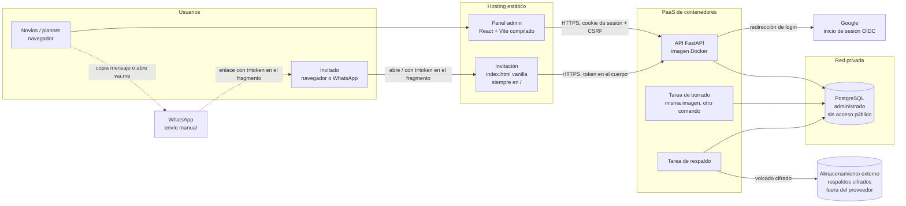

# 1. Componentes

Basado en ADR 0002, 0003, 0004, 0005, 0010 y 0013.

## Diagrama general

## Componentes

| Componente | Responsabilidad | ADR |
|---|---|---|
| **Invitación** | Página pública estática y sin framework. Lee el token del fragmento, consulta y guarda la respuesta. Sin token, muestra todo menos el formulario | 0002, 0011, 0013 |
| **Panel admin** | Aplicación React + Vite para novios y planner: invitaciones, enlaces, importación, exportación, recordatorios, estadísticas | 0003 |
| **API FastAPI** | Única puerta a los datos. Valida todas las reglas, autentica, autoriza, audita, cifra y busca tokens | 0002, 0005, 0008 |
| **PostgreSQL** | Persistencia y restricciones de integridad. Solo accesible desde la red privada, con un usuario de privilegios mínimos | 0002, 0004 |
| **Tarea de borrado** | Ejecuta la purga del 5 abr y del 4 jun 2027 de forma idempotente | 0010 |
| **Tarea de respaldo** | Volcado diario cifrado hacia un almacenamiento fuera del proveedor, con vencimientos | 0004, 0010 |
| **Google** | Identidad de los administradores. Solo se aceptan correos de las listas configuradas | 0005 |
| **WhatsApp** | Canal manual. El sistema no envía mensajes; el panel prepara el texto o un enlace `wa.me` | 0003 |

## Orígenes y límites de confianza

- **Invitación** y **panel** son orígenes distintos de la API. La API permite CORS solo a esos dos orígenes, configurados por variable de entorno.
- **Sugerencia:** servir panel y API como subdominios del mismo dominio propio (p. ej. `panel.[dominio]` y `api.[dominio]`). Así la cookie de sesión es del mismo sitio y puede usar `SameSite=Lax` o `Strict`. Depende del dominio (pendiente).
- **Límite de confianza 1:** todo lo que llega de la invitación es anónimo, salvo el token. La API trata el token como la única credencial del invitado.
- **Límite de confianza 2:** el panel solo opera con una sesión válida de un correo autorizado; la API verifica el rol en cada petición.
- **Límite de confianza 3:** la base de datos no es accesible desde internet. Solo la API y las tareas (misma imagen) se conectan.
- **Fuera del sistema:** las exportaciones descargadas y los mensajes de WhatsApp quedan fuera de su control (ver [10-respaldos.md](10-respaldos.md) y ADR 0010).
