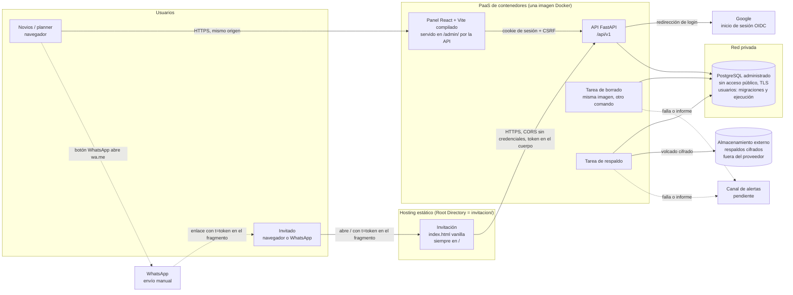

# 1. Componentes

Basado en ADR 0002, 0004, 0005, 0010, 0013, 0015, 0019 y 0020.

## Diagrama general

## Componentes

| Componente | Responsabilidad | ADR |
|---|---|---|
| **Invitación** | Página pública estática y sin framework, en `invitacion/`. Lee el token del fragmento, consulta y guarda la respuesta. Sin token, muestra todo menos el formulario | 0002, 0011, 0013, 0016, 0020 |
| **API FastAPI** | Única puerta a los datos. Valida las reglas, autentica, autoriza, audita, cifra y busca tokens. Además **sirve el panel compilado** en `/admin/` | 0002, 0005, 0008, 0015, 0019 |
| **Panel admin** | React + Vite con build propio y enrutado por hash, incluido en la imagen de la API: invitaciones, enlaces, importación, exportación, recordatorios, estadísticas | 0003, 0015, 0017 |
| **PostgreSQL** | Persistencia y restricciones. Red privada, TLS, usuario de migraciones separado del de ejecución | 0002, 0004, 0019 |
| **Tarea de borrado** | Purga del 5 abr y del 4 jun 2027; idempotente; informe de conteos y alerta si falla | 0010, 0019 |
| **Tarea de respaldo** | Volcado diario cifrado fuera del proveedor, con vencimientos; alerta si falla | 0004, 0010, 0019 |
| **Google** | Identidad de los administradores (listas de correos) | 0005 |
| **WhatsApp** | Canal manual: el panel abre `wa.me` al teléfono principal o al contacto alterno y marca el enlace como enviado | 0003, 0017 |

## Orígenes y límites de confianza

- **Dos orígenes:** la invitación (hosting estático) y la API, que incluye el panel.
- **CORS:** solo la API pública acepta el origen de la invitación, **sin credenciales**. El panel no usa CORS porque es el mismo origen (ADR 0015).
- **Límite 1:** lo que llega de la invitación es anónimo salvo el token, que es la única credencial del invitado.
- **Límite 2:** el panel solo opera con una sesión válida de un correo autorizado; el rol se verifica en cada petición.
- **Límite 3:** la DB no es accesible desde internet; solo se conectan la API y las tareas de la misma imagen, por TLS.
- **Fuera del sistema:** exportaciones descargadas y mensajes de WhatsApp (ver ADR 0010 y [10-respaldos.md](10-respaldos.md)).
