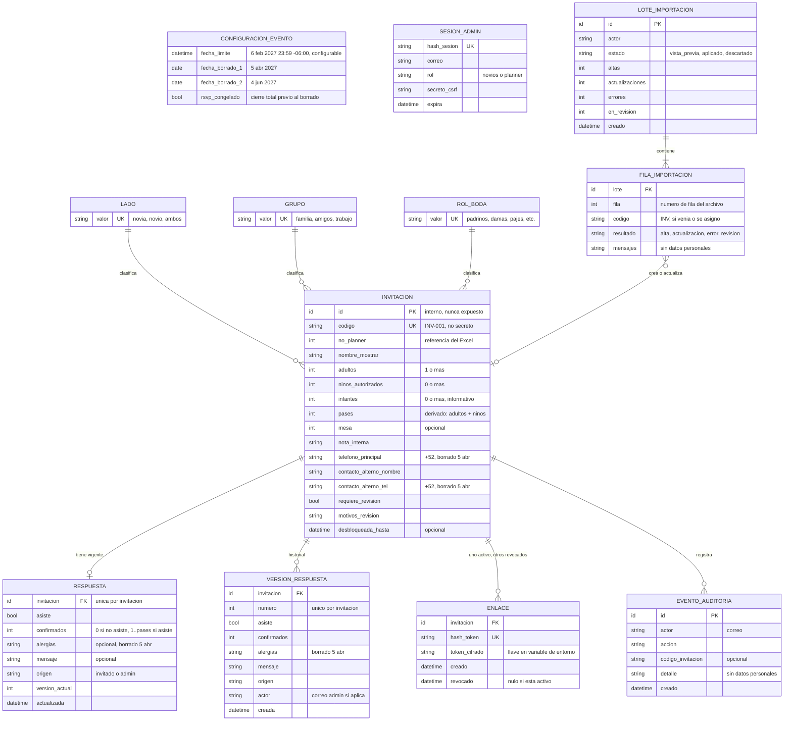

# 2. Modelo de datos conceptual

Basado en ADR 0006, 0007, 0008/0013, 0009 y 0010. Es un modelo conceptual: los nombres y tipos son orientativos y no son SQL.

## Diagrama entidad-relación

## Entidades

| Entidad | Propósito | ADR |
|---|---|---|
| Configuración del evento | Registro único con la fecha límite, las fechas de borrado y el congelamiento del RSVP | 0007, 0010 |
| Invitación | Familia o grupo. Unidad de pases, enlace y respuesta | 0006 |
| Lado / Grupo / Rol de boda | Catálogos cerrados para clasificar y para las estadísticas | 0006 |
| Respuesta | La respuesta vigente (una o ninguna por invitación) | 0007 |
| Versión de respuesta | Historial inmutable de cada cambio | 0007 |
| Enlace | Token de la invitación: hash para buscar, copia cifrada para reenviar | 0008, 0013 |
| Sesión admin | Sesión del panel en el servidor, revocable, con secreto CSRF | 0005 |
| Lote / Fila de importación | Resultado de cada importación, para revisar y auditar | 0009 |
| Evento de auditoría | Quién hizo qué y cuándo en el panel | 0005, 0009 |

No existe una tabla de administradores ni de contraseñas: el rol se deriva de las listas de correos en variables de entorno (ADR 0005). Tampoco existen personas individuales (ADR 0006).

## Cardinalidades

- Invitación **1 — 0..1** Respuesta vigente.
- Invitación **1 — 0..N** Versión de respuesta. La vigente equivale a la última versión.
- Invitación **1 — 0..N** Enlace, con **como máximo 1 activo** (sin fecha de revocación).
- Invitación **N — 1** Lado, Grupo y Rol de boda. **Sugerencia:** los tres son opcionales al dar de alta, porque el Excel de la planner no siempre trae Grupo y Rol.
- Lote de importación **1 — 1..N** Filas. Una fila **0..1** Invitación (una fila con error no toca ninguna).

## Restricciones

| # | Restricción | Garantía | ADR |
|---|---|---|---|
| M1 | `adultos ≥ 1`, `ninos_autorizados ≥ 0`, `infantes ≥ 0` | Ambas | 0006 |
| M2 | `pases = adultos + ninos_autorizados`; se deriva, no se captura por separado | Ambas | 0006 |
| M3 | `codigo` único; formato `INV-` + número | Ambas | 0009 |
| M4 | Una sola respuesta vigente por invitación | DB | 0007 |
| M5 | Si `asiste` es falso, `confirmados = 0`; si es verdadero, `1 ≤ confirmados ≤ pases` | Ambas (el límite superior depende de otra tabla: API + validación en la DB) | 0007 |
| M6 | No se pueden bajar los pases por debajo de `confirmados` de la respuesta vigente | Ambas | 0006 |
| M7 | `hash_token` único; como máximo un enlace activo por invitación | DB | 0008 |
| M8 | No se crea un enlace si `requiere_revision` es verdadero | API | 0009 |
| M9 | `numero` de versión único y creciente por invitación; las versiones no se modifican ni se borran salvo por la purga | Ambas | 0007, 0010 |
| M10 | Lado, Grupo y Rol solo aceptan valores del catálogo | DB | 0006 |
| M11 | Teléfonos normalizados a formato internacional (+52) | API | 0006 |
| M12 | Longitud máxima en `alergias`, `mensaje`, `nombre_mostrar` y `nota_interna` | Ambas | 0007 |
| M13 | `mensajes` de importación y `detalle` de auditoría no contienen datos personales (se refieren a fila, columna o código INV) | API | 0010 |

## Clasificación para el borrado (ADR 0010)

| Dato | Entidad | Se borra |
|---|---|---|
| Teléfono principal, teléfono del contacto alterno | Invitación | **5 abr 2027** |
| Alergias | Respuesta **y** Versión de respuesta | **5 abr 2027** |
| Nombre a mostrar, nombre del contacto alterno, nota interna, mesa | Invitación | 4 jun 2027 |
| Mensaje y demás campos de respuesta | Respuesta, Versión de respuesta | 4 jun 2027 |
| Hash y copia cifrada del token | Enlace | 4 jun 2027 |
| Correos de administradores | Sesión, Auditoría, Lote, Versión (actor) | 4 jun 2027 |
| Filas y lotes de importación | Lote / Fila | 4 jun 2027 |
| Catálogos y configuración | — | No son datos personales; se eliminan al apagar el sistema |

El nombre del contacto alterno no es un teléfono, así que se borra en la segunda fase, igual que el resto de los nombres.
