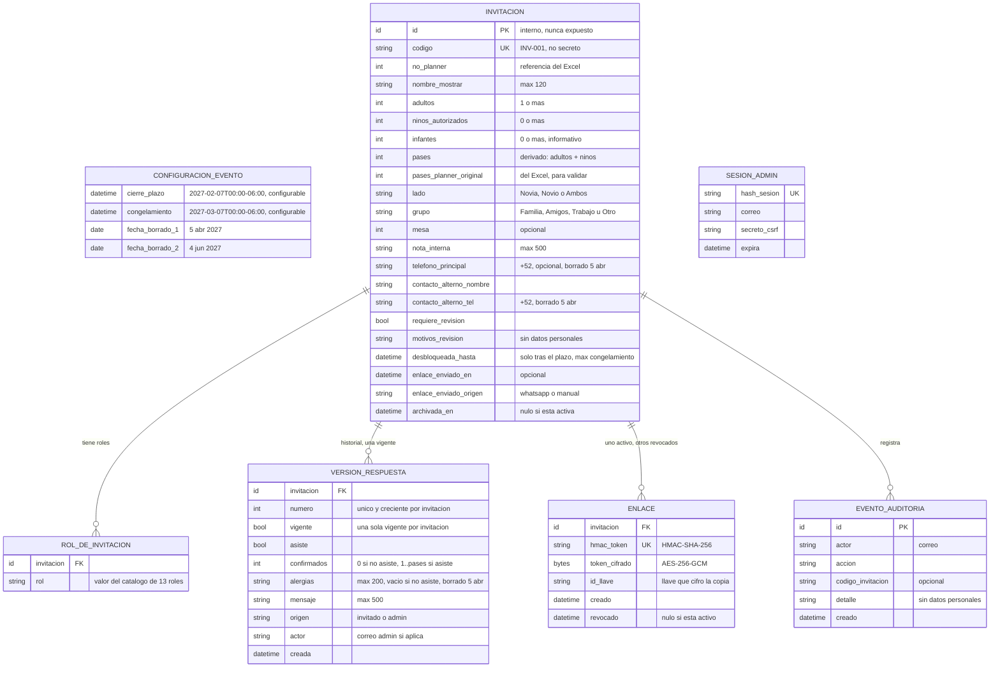

# 2. Modelo de datos conceptual

Basado en ADR 0006, 0007, 0008/0013, 0009/0018, 0010, 0016, 0017 y 0019. Es un modelo conceptual: los nombres y tipos son orientativos y no son SQL. Incluye las simplificaciones aceptadas en la Fase 3: catálogos como valores cerrados, una sola tabla de respuestas e importación sin estado.

## Diagrama entidad-relación

## Entidades

| Entidad | Propósito | ADR |
|---|---|---|
| Configuración del evento | Registro único con cierre del plazo, congelamiento y fechas de borrado | 0010, 0016 |
| Invitación | Familia o grupo. Unidad de pases, enlace y respuesta. Lado y grupo como valores cerrados | 0006, 0017 |
| Rol de invitación | Cero, uno o varios roles del catálogo por invitación | 0017 |
| Versión de respuesta | Historial inmutable; la marcada como vigente es la respuesta actual | 0007 |
| Enlace | Token de la invitación: HMAC para buscar, copia cifrada para reenviar | 0008, 0013, 0019 |
| Sesión admin | Sesión del panel en el servidor, revocable, con secreto CSRF. El rol se resuelve contra las listas en cada petición | 0005, 0015 |
| Evento de auditoría | Quién hizo qué y cuándo en el panel, incluido el resumen de cada importación | 0005, 0018 |

Ya no existen las entidades Lote ni Fila de importación (ADR 0018: importación sin estado), ni tablas de catálogos (valores cerrados validados en la DB). Tampoco existen administradores con contraseña ni personas individuales.

## Cardinalidades

- Invitación **1 — 0..N** Versión de respuesta, con **como máximo 1 vigente**.
- Invitación **1 — 0..N** Enlace, con **como máximo 1 activo**. Una invitación archivada no tiene enlace activo.
- Invitación **1 — 0..N** Rol de invitación; sin roles repetidos dentro de la misma invitación.
- Lado y grupo: opcionales al dar de alta, porque el Excel no siempre trae Grupo. El lado viene de "Invitado de".

## Restricciones

| # | Restricción | Garantía | ADR |
|---|---|---|---|
| M1 | `adultos ≥ 1`, `ninos_autorizados ≥ 0`, `infantes ≥ 0` | Ambas | 0006 |
| M2 | `pases = adultos + ninos_autorizados` (derivado) | Ambas | 0006 |
| M3 | `codigo` único, formato `INV-` + número | Ambas | 0009 |
| M4 | Como máximo una versión vigente por invitación | DB | 0007 |
| M5 | Si `asiste` es falso: `confirmados = 0` y `alergias` vacío. Si es verdadero: `1 ≤ confirmados ≤ pases` | Ambas | 0007, 0017 |
| M6 | No se pueden bajar los pases por debajo de los confirmados vigentes | Ambas | 0006 |
| M7 | `hmac_token` único; como máximo un enlace activo por invitación | DB | 0008 |
| M8 | No se crea enlace si `requiere_revision` o `archivada_en` | API | 0009, 0017 |
| M9 | Las versiones no se modifican ni se borran, salvo por la purga | Ambas | 0007, 0010 |
| M10 | Lado, grupo y rol solo aceptan valores de sus catálogos | DB | 0017 |
| M11 | Teléfonos en formato internacional (+52) | API | 0006 |
| M12 | Longitudes: nombre 120, mensaje 500, alergias 200, nota 500 | Ambas | 0017 |
| M13 | `desbloqueada_hasta` solo después del cierre del plazo y como máximo el congelamiento | API | 0016 |
| M14 | `detalle` de auditoría y `motivos_revision` sin datos personales | API | 0010, 0019 |

## Clasificación para el borrado (ADR 0010)

| Dato | Entidad | Se borra |
|---|---|---|
| Teléfono principal, teléfono del contacto alterno | Invitación | **5 abr 2027** |
| Alergias | Versión de respuesta (todas) | **5 abr 2027** |
| Nombre a mostrar, nombre del contacto alterno, nota, mesa, roles | Invitación, Rol de invitación | 4 jun 2027 |
| Mensaje y demás campos de respuesta | Versión de respuesta | 4 jun 2027 |
| HMAC y copia cifrada del token | Enlace | 4 jun 2027 |
| Correos de administradores | Sesión, Auditoría, Versión (actor) | 4 jun 2027 |
| Invitaciones archivadas | Todas sus entidades | 4 jun 2027 (o antes, en las mismas fases) |
| Configuración | — | No es dato personal; se elimina al apagar el sistema |

## Implementación (fase I-2)

El esquema vive en `api/migrations/versions/0001_esquema_inicial.py` (SQL escrito a mano). Las sugerencias marcadas **(sug.)** fueron aprobadas por Mayra el 3 nov 2026.

| Regla | Cómo la garantiza la DB |
|---|---|
| M1, M3, M10, M12 | `CHECK`, `UNIQUE` y `varchar(n)` (cuenta caracteres, no bytes) |
| M2 | `pases` es una **columna generada** (`adultos + ninos_autorizados`): nadie puede escribir otro valor |
| M4 | Índice único parcial `version_una_vigente` (`WHERE vigente`) |
| M5 | `CHECK version_asistencia_coherente` + disparador `version_confirmados_no_exceden_pases` (bloquea la invitación con `FOR SHARE`) |
| M6 | Disparador `invitacion_pases_no_bajo_confirmados` |
| M7 | `UNIQUE (hmac_token)` + índice único parcial `enlace_uno_activo` (`WHERE revocado_en IS NULL`) |
| M9 | Disparador `version_inmutable` (solo permite vigente true → false y alergias → NULL) + permiso `UPDATE` por columna para el usuario de ejecución |
| M11 (sug.) | `CHECK` de forma E.164 (`^\+[1-9][0-9]{7,14}$`); la normalización a +52 sigue en la API |
| M14 (sug.) | `motivos_revision` solo acepta códigos cerrados: `pases_inconsistentes`, `lado_invalido`, `grupo_invalido`, `telefono_invalido`, `rol_invalido`; `requiere_revision = (hay motivos)` |
| Alergias vacías (sug.) | Siempre `NULL`, nunca cadena vacía |
| Fechas (sug.) | `cierre_plazo < congelamiento < fecha_borrado_1 < fecha_borrado_2`; configuración de un solo registro y **solo lectura** para el usuario de ejecución (cambiarla requiere una migración) |
| A12 | La aplicación no borra invitaciones: guarda de SQLAlchemy (`app/guardas.py`) + test estático; solo la purga (I-10) puede, marcando la sesión |

M8 y M13 siguen siendo de la API (I-3 e I-7).

### Concurrencia

Antes de **crear una versión de respuesta** o de **modificar pases**, la API bloquea la fila de la invitación con `SELECT … FOR UPDATE` (`app/respuestas.py`, `bloquear_invitacion`). Dos envíos simultáneos de la misma invitación se serializan: el segundo espera, ve la versión del primero y termina con **exactamente una vigente** y numeración consecutiva (test `tests/db/test_concurrencia.py`). Si la API olvidara el bloqueo, el índice único parcial rechaza la segunda vigente (mismo test).

### Usuarios de la DB (ADR 0019)

| | Migraciones (`ma_migrator`) | Ejecución (`ma_app`) |
|---|---|---|
| Esquema | Dueño de la base y de todas las tablas | Solo `USAGE`; sin `CREATE`, sin `TEMP` |
| `configuracion_evento` | — | `SELECT` |
| `invitacion` | — | `SELECT, INSERT, UPDATE, DELETE` (el `DELETE` es para la purga) |
| `invitacion_rol`, `sesion_admin`, `evento_auditoria` | — | `SELECT, INSERT, DELETE` |
| `version_respuesta` | — | `SELECT, INSERT, DELETE` + `UPDATE (vigente, alergias)` |
| `enlace` | — | `SELECT, INSERT, DELETE` + `UPDATE (revocado_en, hmac_token, token_cifrado, id_llave)` |
