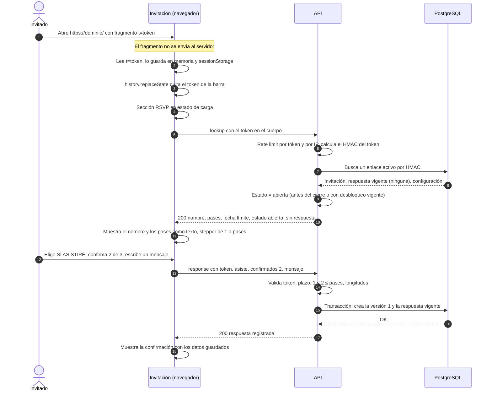
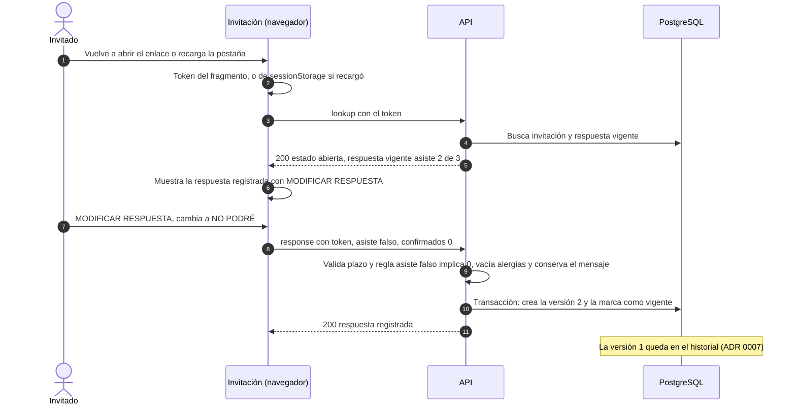
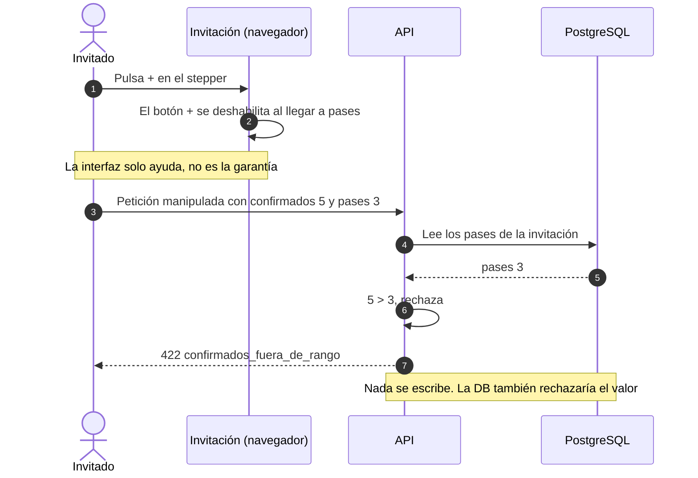
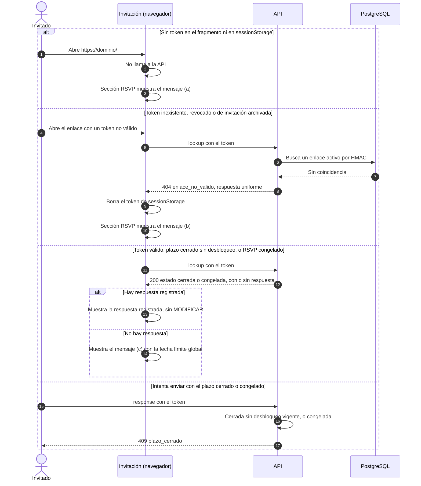

# 3. Flujos del invitado

Basado en ADR 0007, 0008, 0011, 0013, 0016, 0017 y 0019. Los endpoints están detallados en [07-contratos-api.md](07-contratos-api.md). La API busca el token por su HMAC-SHA-256 y aplica rate limiting por token y por IP en cada petición.

- `POST /api/v1/public/invitation/lookup`: consulta la invitación (el token va en el cuerpo).
- `POST /api/v1/public/invitation/response`: guarda la respuesta (el token va en el cuerpo).

## 3.1 El invitado abre su enlace y confirma

## 3.2 El invitado modifica su respuesta

## 3.3 El invitado intenta exceder sus pases

El invitado tampoco puede aumentar los pases ni agregar niños: la API pública no tiene ningún campo para hacerlo (ADR 0006).

## 3.4 Plazo vencido, token inválido o sin token

Textos (a), (b) y (c): ADR 0011 y 0016, pendientes del canal de contacto y de la aprobación visual de I-5. Para el invitado, "congelada" se ve igual que "cerrada". En todos los casos, el resto de la invitación se muestra completo.
