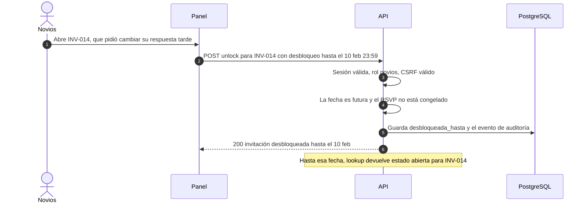
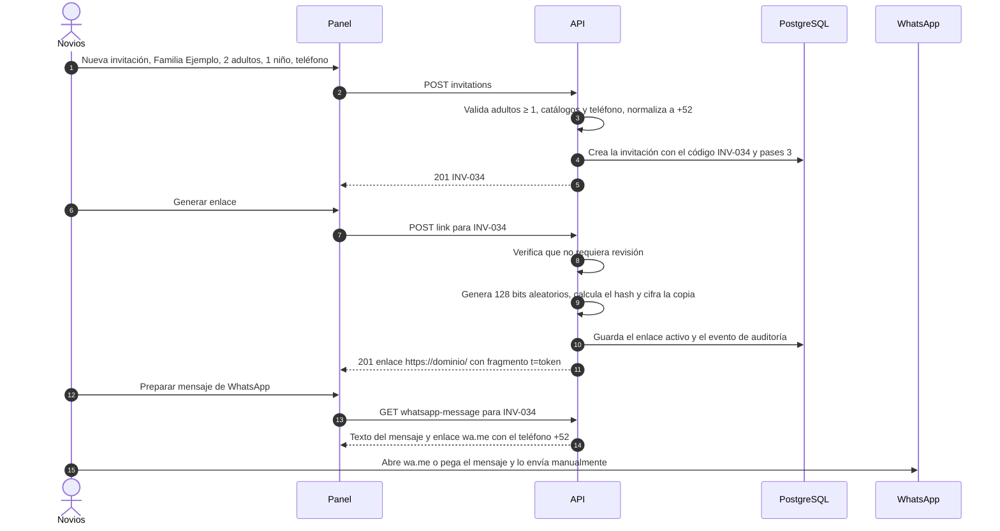
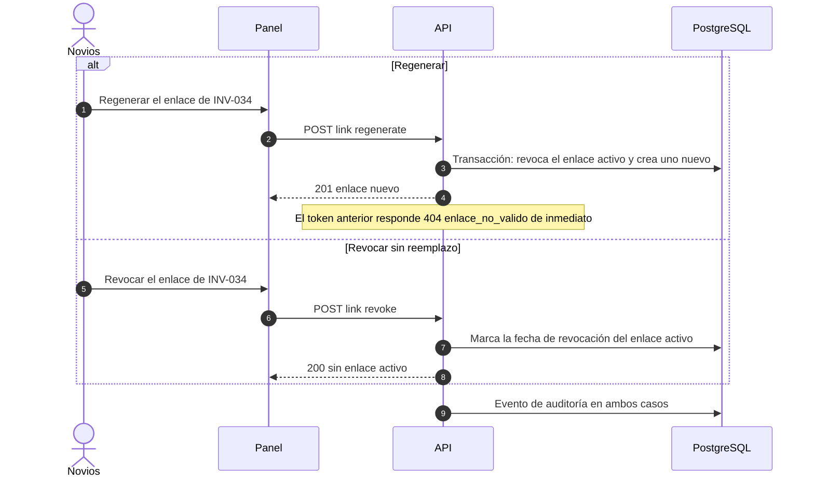
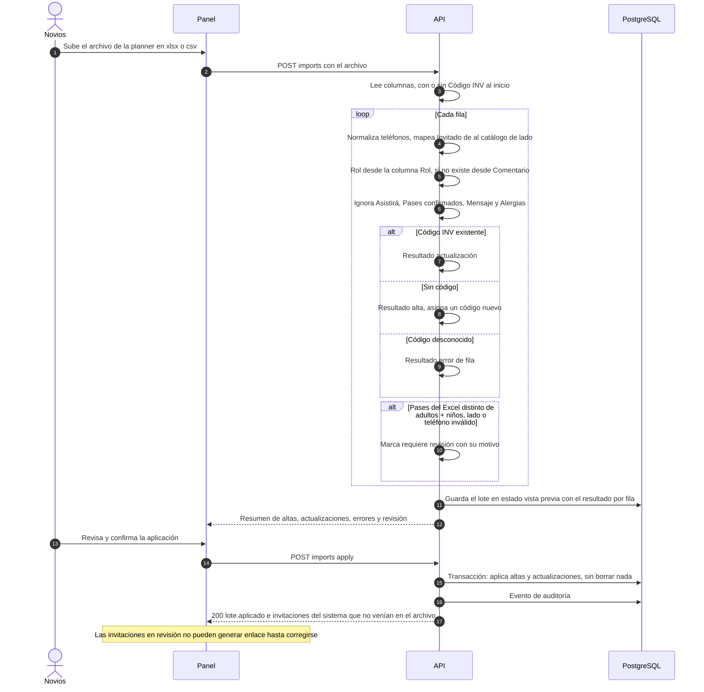
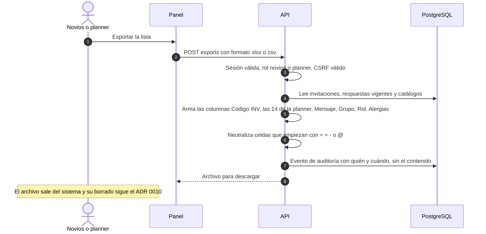
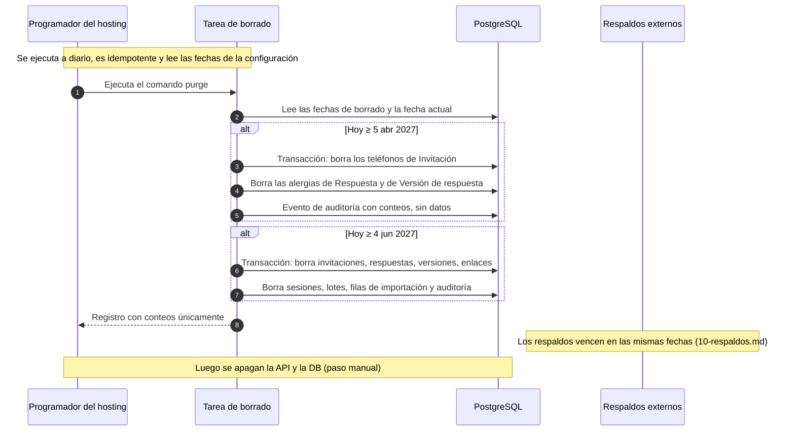

# 4. Flujos del panel administrativo

Basado en ADR 0003, 0005, 0007, 0008/0013, 0009 y 0010. Todas las peticiones del panel llevan la cookie de sesión y, si modifican datos, el encabezado CSRF ([06-autenticacion-autorizacion.md](06-autenticacion-autorizacion.md)). Toda acción relevante genera un evento de auditoría.

## 4.1 El admin desbloquea una invitación

Con rol planner, la API responde `403`. Después del congelamiento previo al borrado no se puede desbloquear (**sugerencia aceptada**, regla C6 de [05-reglas-de-negocio.md](05-reglas-de-negocio.md)).

## 4.2 El admin crea una invitación, genera su enlace y lo envía por WhatsApp

El texto del mensaje de WhatsApp lo definen los novios; no se inventa. Queda como pendiente.

## 4.3 El admin regenera o revoca un enlace

## 4.4 Importación del Excel de la planner con filas en revisión

La vista previa antes de aplicar es una **sugerencia aceptada** que complementa al ADR 0009: evita aplicar un archivo equivocado.

Si una fila reimportada marca para revisión una invitación que **ya tiene enlace activo**, el enlace sigue funcionando y el panel solo muestra un aviso. La marca impide generar o regenerar el enlace hasta corregirla (**sugerencia aceptada**, regla E13).

## 4.5 Exportación

Antes del 5 abr la exportación incluye teléfonos y alergias. Después, esas columnas salen vacías porque los datos ya no existen.

## 4.6 Borrado programado del 5 abr y del 4 jun 2027

Pasos previos manuales, antes del 5 abr: congelar el RSVP, hacer la exportación final y el respaldo final. El 5 abr hay que borrar la exportación final descargada o reemplazarla por una versión sin teléfonos ni alergias (ADR 0010).
