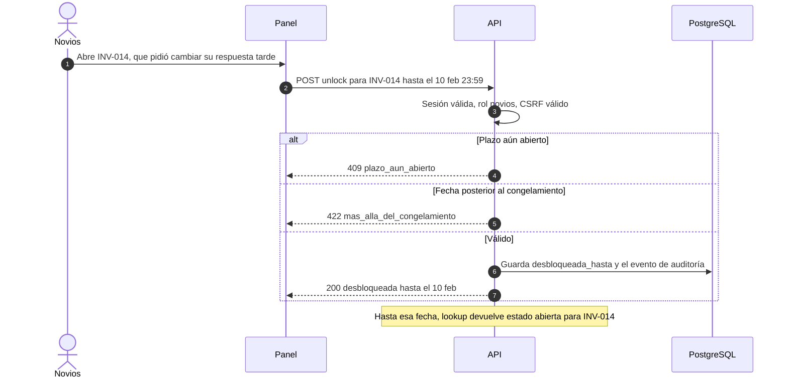
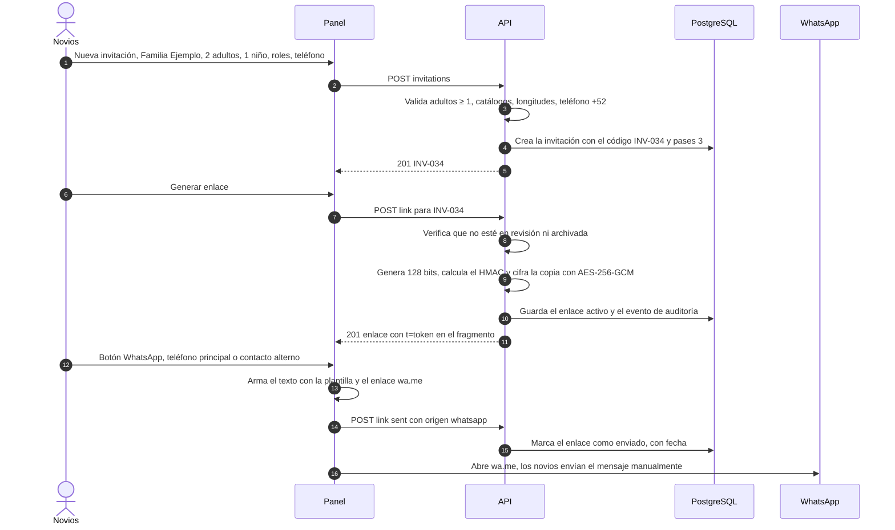
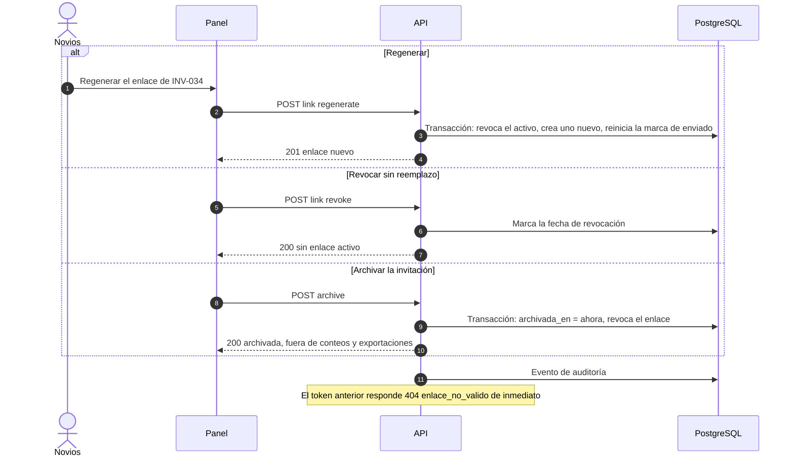
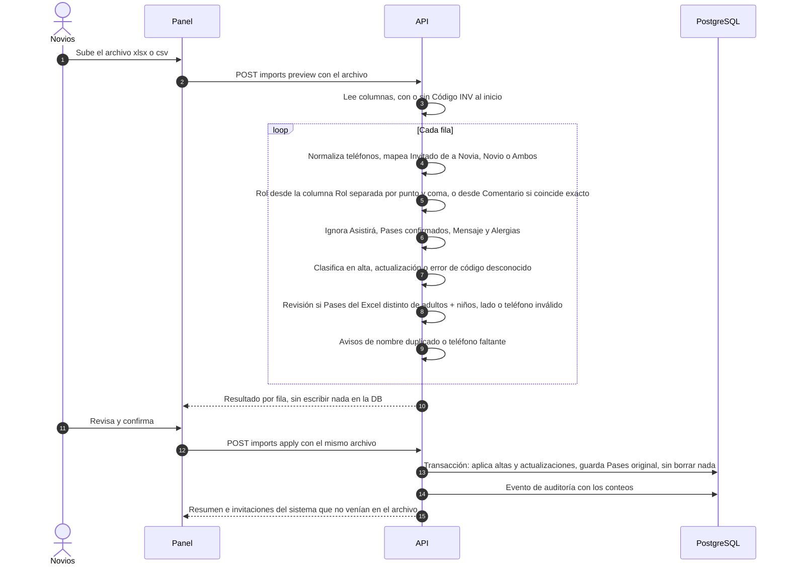
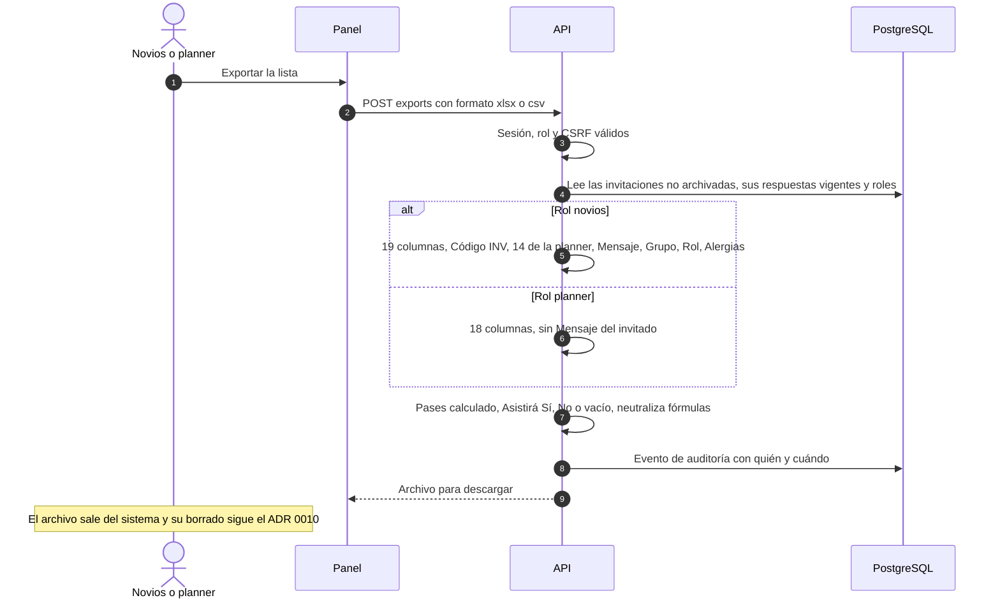
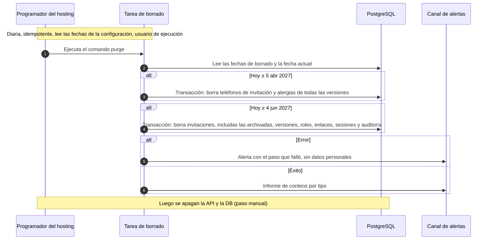

# 4. Flujos del panel administrativo

Basado en ADR 0003/0015, 0005, 0007/0016, 0008/0013, 0009/0018, 0010, 0017 y 0019. El panel lo sirve la API (mismo origen). Las escrituras llevan cookie de sesión y `X-CSRF-Token` ([06](06-autenticacion-autorizacion.md)). Toda acción relevante genera un evento de auditoría sin datos personales. Después del congelamiento (7 mar 2027) solo se permite leer y exportar.

## 4.1 El admin desbloquea una invitación

Con rol planner, la API responde `403`. Tras el congelamiento, `409 rsvp_congelado` (ADR 0016).

## 4.2 El admin crea una invitación, genera su enlace y lo envía por WhatsApp

Si la invitación no tiene teléfono, el panel muestra un aviso y permite copiar el mensaje y marcarlo como enviado a mano. La plantilla del mensaje está pendiente (Q9).

## 4.3 El admin regenera, revoca o archiva

## 4.4 Importación del Excel de la planner (sin estado)

Si una invitación con enlace activo queda en revisión, el enlace sigue funcionando y el panel avisa (regla D7). La marca de revisión se quita sola cuando se corrige la inconsistencia (ADR 0018).

## 4.5 Exportación

## 4.6 Borrado programado del 5 abr y del 4 jun 2027

Previo: congelamiento el 7 mar 2027 00:00; exportación y respaldo finales antes del 5 abr. El 5 abr hay que borrar la exportación final descargada o reemplazarla por una versión sin teléfonos ni alergias (ADR 0010).
