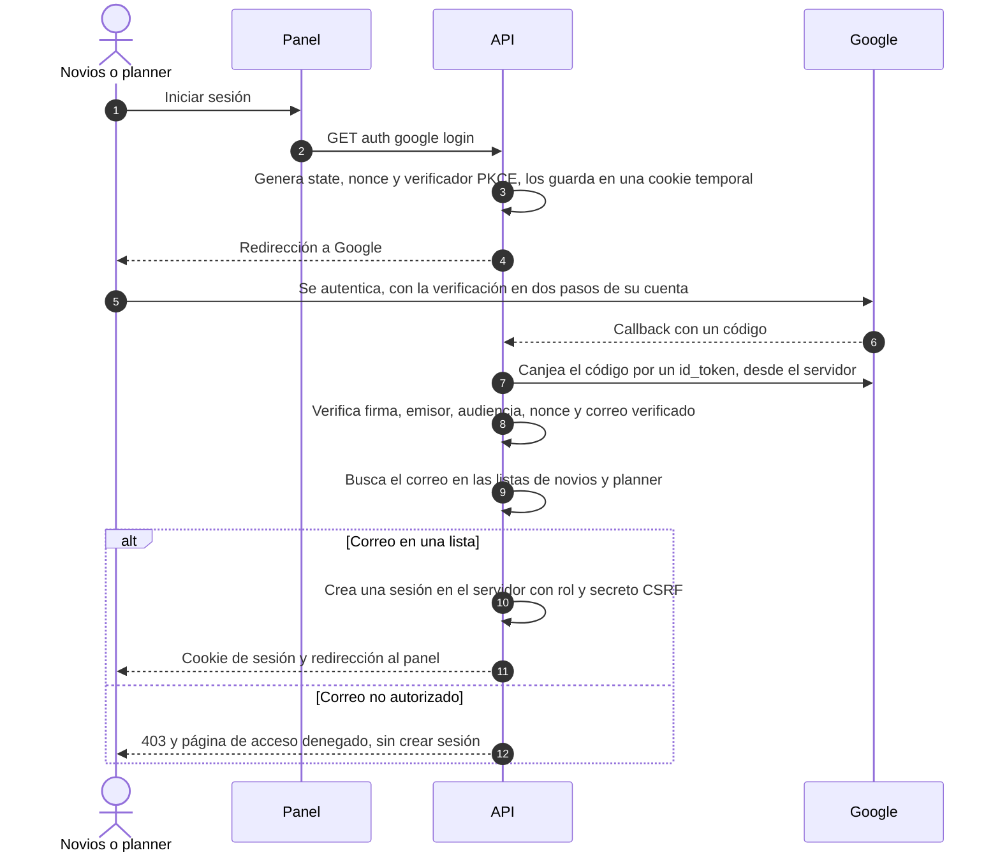

# 6. Autenticación y autorización

Basado en ADR 0005, 0008 y 0013.

## 6.1 Invitado: token de invitación

| Aspecto | Diseño |
|---|---|
| Credencial | El token de 128 bits del enlace `https://[dominio]/#t=<token>` (ADR 0013). Es la única credencial; no hay cuentas ni contraseñas |
| Transporte | Va en el **cuerpo JSON** de peticiones `POST` por HTTPS. Nunca en la URL, en parámetros de consulta ni en cookies |
| Almacenamiento en el navegador | Memoria + `sessionStorage` solo durante la visita (con try/catch). Se borra si la API responde `enlace_no_valido` |
| Búsqueda | La API calcula el hash del token y busca un enlace activo por hash. El token en claro no se guarda ni se registra |
| Respuesta ante fallo | Token inexistente y revocado reciben la misma respuesta `404 enlace_no_valido` (**sugerencia**), para no revelar cuál es cuál |
| Alcance | Un token solo permite leer y responder **su** invitación: nombre a mostrar, pases, fecha límite, estado y respuesta vigente. Nunca categorías, mesa, teléfonos ni notas |
| Abuso | Rate limiting por IP en lookup y response; tamaño máximo de cuerpo; el tiempo de respuesta no debe delatar si el token existe |
| Logs | La API filtra el campo del token antes de registrar cualquier petición o error (ADR 0008) |
| Encabezados | `Cache-Control: no-store` en todas las respuestas públicas |

## 6.2 Panel: Google restringido y roles

### Inicio de sesión

- El canje del código lo hace **la API, no el navegador** (code flow con PKCE en el servidor). El panel nunca maneja tokens de Google.
- Listas de correos: dos variables de entorno, una por rol (ver [11-despliegue.md](11-despliegue.md)). Se comparan en minúsculas y exactas, sin dominios comodín.
- El rol se vuelve a resolver contra las listas en cada petición, no solo al iniciar sesión. Así, quitar un correo de la lista corta el acceso en cuanto se reinicia el servicio con la nueva configuración.

### Sesión y cookies

| Aspecto | Diseño |
|---|---|
| Tipo | Sesión guardada en el servidor (entidad Sesión admin), revocable. La cookie solo lleva un identificador aleatorio; en la DB se guarda su hash |
| Cookie | `Secure`, `HttpOnly`, `SameSite=Lax` (o `Strict` si el panel y la API comparten sitio), `Path=/`, prefijo `__Host-` si el despliegue lo permite |
| Duración | **Sugerencia:** expira tras 8 h de inactividad y como máximo a los 7 días |
| Cierre | `POST logout` borra la sesión en el servidor y la cookie |

### CSRF

- Toda petición del panel que modifica datos (`POST`, `PUT`, `PATCH`, `DELETE`) debe llevar el encabezado `X-CSRF-Token` con el secreto de la sesión, que el panel obtiene de `GET auth me`.
- La API compara ese encabezado con el secreto de la sesión y además verifica `Origin` contra la lista de orígenes permitidos.
- CORS: solo los orígenes del panel y de la invitación, cada uno con sus métodos. Las credenciales (cookies) solo se aceptan desde el origen del panel.

### Matriz de permisos

| Acción | Novios | Planner | Invitado (token) |
|---|:-:|:-:|:-:|
| Ver su propia invitación y responder | — | — | ✔ (solo la suya, dentro del plazo) |
| Ver invitaciones, respuestas, historial y estadísticas | ✔ | ✔ | — |
| Crear o editar invitaciones, categorías, mesa, teléfonos | ✔ | — | — |
| Importar | ✔ | — | — |
| Exportar | ✔ | ✔ | — |
| Ver enlace, generar, regenerar o revocar | ✔ | — (aceptada) | — |
| Preparar el mensaje de WhatsApp | ✔ | — (aceptada) | — |
| Desbloquear una invitación | ✔ | — | — |
| Registrar respuesta en nombre del invitado | ✔ | — | — |
| Cambiar la configuración (fecha límite, congelar) | ✔ | — | — |
| Ver la auditoría | ✔ | — (aceptada) | — |

La planner tiene "solo lectura + exportación" (ADR 0005), así que no ve ni copia enlaces: un enlace permite responder en nombre del invitado. Si los novios quieren que la planner envíe recordatorios, hace falta un ADR nuevo.
