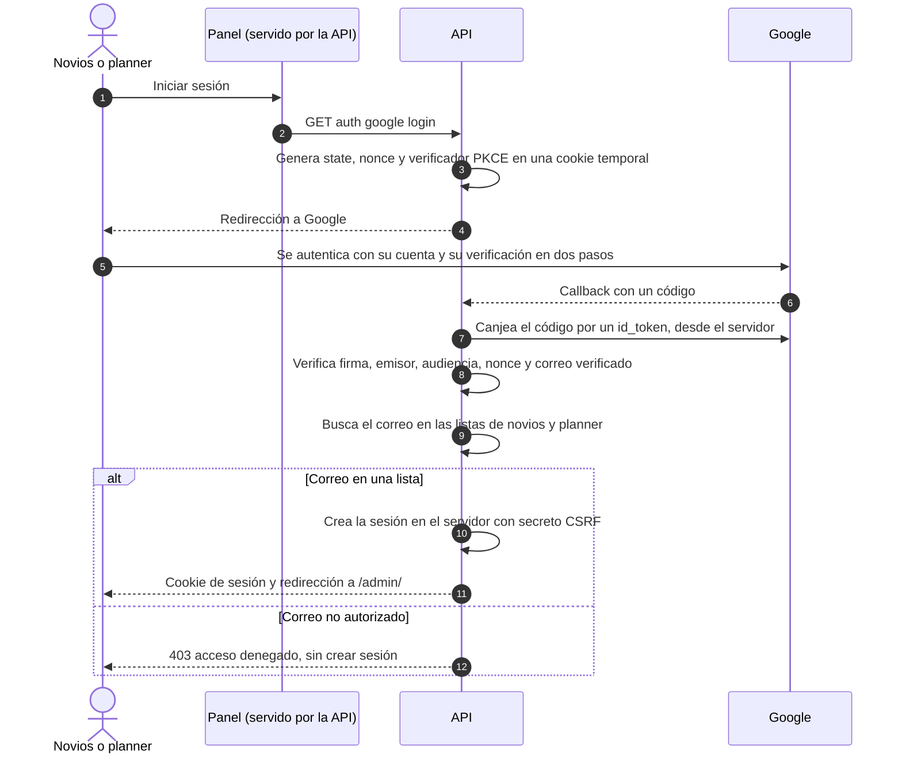

# 6. Autenticación, autorización y protección

Basado en ADR 0005, 0008, 0013, 0015, 0017 y 0019.

## 6.1 Invitado: token de invitación

| Aspecto | Diseño |
|---|---|
| Credencial | El token de 128 bits del enlace `https://[dominio]/#t=<token>` (ADR 0013). Es la única credencial; no hay cuentas ni contraseñas |
| Transporte | Va en el **cuerpo JSON** de peticiones `POST` por HTTPS. Nunca en la URL, en parámetros de consulta ni en cookies |
| Almacenamiento en el navegador | Memoria + `sessionStorage` solo durante la visita (con try/catch). Se borra si la API responde `enlace_no_valido` |
| Búsqueda | La API calcula el **HMAC-SHA-256** del token con `TOKEN_HASH_KEY` y busca un enlace activo. El token en claro no se guarda ni se registra (ADR 0019) |
| Respuesta ante fallo | Token inexistente, revocado o de invitación archivada → la misma respuesta `404 enlace_no_valido` (ADR 0016) |
| Alcance | Un token solo permite leer y responder **su** invitación: nombre a mostrar, pases, fecha límite, estado y respuesta vigente |
| Abuso | Rate limiting **por token (estricto)** y **por IP (generoso)**; cuerpo máximo de 4 KB (ADR 0019) |
| Encabezados | `Cache-Control: no-store` en todas las respuestas públicas |

## 6.2 Panel: Google restringido, mismo origen

El panel lo sirve la propia API en el mismo origen (p. ej. `https://api.[dominio]/admin/`), con enrutado por hash (ADR 0015). No hay CORS para el panel.

### Inicio de sesión

- El canje del código lo hace la API (code flow con PKCE en el servidor). El panel nunca maneja tokens de Google.
- Las listas de correos vienen de dos variables de entorno, se comparan en minúsculas y exactas, y el rol se resuelve **en cada petición**.
- El proyecto OAuth de Google lo crea Mayra (Claude no crea servicios). La URI de redirección depende del origen de la API.

### Sesión y cookies

| Aspecto | Diseño |
|---|---|
| Tipo | Sesión en el servidor, revocable. La cookie lleva un identificador aleatorio; en la DB se guarda su hash |
| Cookie | `__Host-` + `Secure`, `HttpOnly`, `SameSite=Strict`, `Path=/` (posible al ser el mismo origen, ADR 0015) |
| Duración | Expira tras 8 h de inactividad y como máximo a los 7 días |
| Cierre | `POST logout` borra la sesión en el servidor y la cookie |

### CSRF

- Toda petición de escritura del panel lleva `X-CSRF-Token` con el secreto de la sesión (obtenido de `GET auth me`).
- La API compara el encabezado con la sesión y verifica que `Origin` sea su propio origen.

### Matriz de permisos

| Acción | Novios | Planner | Invitado (token) |
|---|:-:|:-:|:-:|
| Ver su invitación y responder | — | — | ✔ (la suya, solo si está abierta) |
| Ver invitaciones, respuestas, historial y estadísticas | ✔ | ✔ **sin mensajes del invitado** | — |
| Ver alergias | ✔ | ✔ | — |
| Crear, editar o archivar invitaciones | ✔ | — | — |
| Importar | ✔ | — | — |
| Exportar | ✔ (19 columnas) | ✔ (18, sin Mensaje) | — |
| Ver, generar, regenerar o revocar enlaces; marcar enviado | ✔ | — | — |
| WhatsApp (principal y contacto alterno) | ✔ | — | — |
| Desbloquear (solo tras el plazo, hasta el congelamiento) | ✔ | — | — |
| Registrar respuesta en nombre del invitado (hasta el congelamiento) | ✔ | — | — |
| Cambiar la configuración (fechas) | ✔ | — | — |
| Ver la auditoría | ✔ | — | — |

Después del congelamiento, los novios también quedan en solo lectura + exportación (ADR 0016).

## 6.3 Protección transversal (ADR 0019)

### Encabezados HTTP

| Encabezado | API y panel | Invitación (hosting estático) |
|---|---|---|
| `Content-Security-Policy` | `default-src 'self'; script-src 'self'; style-src 'self'; img-src 'self' data:; connect-src 'self'; frame-ancestors 'none'; base-uri 'none'; form-action 'self'` | `default-src 'none'; script-src 'sha256-<hash del script inline>'; style-src 'self' 'unsafe-inline' https://fonts.googleapis.com; font-src https://fonts.gstatic.com; img-src 'self' data:; connect-src <origen de la API>; base-uri 'none'`, más `frame-ancestors 'none'` si el hosting envía encabezados |
| `Strict-Transport-Security` | `max-age=31536000; includeSubDomains` con dominio definitivo | Igual, si el hosting lo permite |
| `X-Content-Type-Options` | `nosniff` | `nosniff` |
| `Referrer-Policy` | `no-referrer` | `no-referrer` |

En la invitación, `style-src` necesita `'unsafe-inline'` porque el diseño congelado usa atributos `style`. Lo que el hosting no pueda enviar como encabezado se declara con `<meta>` en I-5, con aprobación.

### Límites

| Límite | Valor inicial (configurable) |
|---|---|
| Rate limiting por token | 20 consultas y 10 respuestas por hora |
| Rate limiting por IP | 300 peticiones por hora |
| Cuerpo máximo | Pública 4 KB · panel 64 KB · archivo de importación 2 MB |

### Logs y errores

- Lista cerrada de campos: ruta sin parámetros, método, código de estado, duración, identificador de petición y código INV cuando aplique.
- Nunca: cuerpos, tokens, nombres, teléfonos, alergias, mensajes ni notas.
- Errores sin valores de entrada; sin servicios externos de rastreo de errores.
