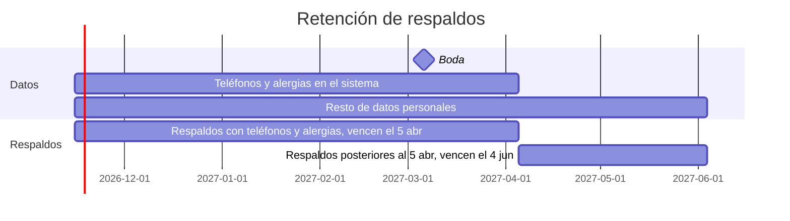

# 10. Respaldos y restauración

Basado en ADR 0004 y 0010.

## Qué se respalda

- La base de datos PostgreSQL completa: invitaciones, respuestas, historial, enlaces (hash + copia cifrada), auditoría, lotes y configuración.
- **No** se respaldan junto a la base:
  - La **llave de cifrado de tokens**: vive en el gestor de secretos del hosting y se guarda aparte. Un respaldo filtrado sin la llave no permite reconstruir los enlaces.
  - Las **listas de correos** ni otros secretos: son configuración, no datos.
- El sitio estático y el código ya están en el repositorio.

## Cómo

| Aspecto | Diseño |
|---|---|
| Frecuencia | Un volcado lógico diario (formato estándar de PostgreSQL, portable entre proveedores) |
| Cifrado | Se cifra **antes** de salir del entorno, con una llave de respaldo distinta de la de tokens, guardada fuera del proveedor |
| Destino | Almacenamiento de objetos **fuera del proveedor del PaaS y del Postgres** (ADR 0004) |
| Ejecución | Tarea programada con la misma imagen Docker o con el mecanismo del hosting; registra solo el éxito, el tamaño y la fecha |
| Respaldos del proveedor | Si el Postgres administrado hace sus propios respaldos o restauraciones a un punto en el tiempo, su retención también se ajusta a las fechas de abajo |

## Vencimientos (alineados con el borrado)

El inicio de las barras es ilustrativo: depende de cuándo arranque el sistema.

| Respaldo tomado | Contiene | Vence |
|---|---|---|
| Antes de la purga del 5 abr 2027 | Teléfonos y alergias | **5 abr 2027** |
| Del 5 abr al 4 jun 2027 | Datos personales sin teléfonos ni alergias | **4 jun 2027** |
| Después del 4 jun 2027 | — | No se toman; el sistema se apaga |

- **Mecanismo sugerido:** una regla de ciclo de vida del almacenamiento de objetos con fecha absoluta, además de borrar cada respaldo en cuanto pasa su fecha. Hay que verificar a mano que se aplicó.
- Si un proveedor no permite fijar fechas de vencimiento absolutas, no sirve para estos respaldos.

## Respaldo y exportación finales

1. Antes del 5 abr 2027: congelar el RSVP, hacer la **exportación final** y el **respaldo final**.
2. El respaldo final contiene teléfonos y alergias, así que **vence el 5 abr**, como cualquier otro.
3. La exportación final descargada se borra o se reemplaza por una versión sin teléfonos ni alergias el **5 abr 2027** (ADR 0010). Este paso es manual de los novios y la planner.
4. Después del 4 jun no queda ningún respaldo con datos personales.

## Restauración

| Paso | Detalle |
|---|---|
| Prueba | **Sugerencia:** antes de enviar las invitaciones, restaurar un respaldo en un entorno aislado y comprobar que la API arranca y que los conteos coinciden. Repetirlo una vez antes del plazo |
| Procedimiento | Crear una DB nueva → restaurar el volcado descifrado → apuntar la API a ella → **ejecutar la tarea de borrado** → reabrir el servicio |
| Borrado tras restaurar | Si la fecha actual ya pasó alguna fecha de borrado, la tarea se ejecuta antes de abrir el servicio (regla F8, **sugerencia aceptada**), para que un respaldo no reintroduzca datos ya borrados |
| Llave de tokens | Con la misma llave, los enlaces existentes siguen funcionando. Si se perdió, hay que regenerar y reenviar todos los enlaces (ADR 0008) |
| Pérdida aceptable | Hasta 24 h de respuestas (frecuencia diaria). Las respuestas perdidas se recuperan pidiendo a los invitados que vuelvan a confirmar, o registrándolas desde el panel |
