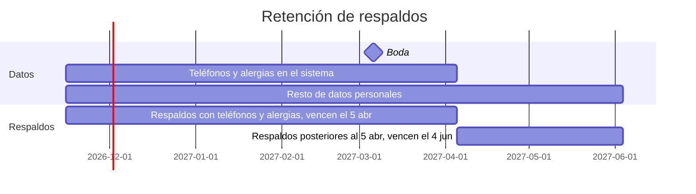

# 10. Respaldos y restauración

Basado en ADR 0004, 0010, 0019 y 0030. Implementado en I-10 (`app/respaldo.py`, `app/purga.py`); el despliegue real está pendiente.

## Qué se respalda

- La base de datos PostgreSQL completa: invitaciones, respuestas, historial, enlaces (HMAC + copia cifrada), roles, auditoría y configuración.
- **No** se respaldan junto a la base:
  - La **llave de cifrado de tokens**: vive en el gestor de secretos del hosting y se guarda aparte. Un respaldo filtrado sin la llave no permite reconstruir los enlaces.
  - Las **listas de correos** ni otros secretos: son configuración, no datos.
- El sitio estático y el código ya están en el repositorio.

## Cómo

| Aspecto | Diseño |
|---|---|
| Frecuencia | Un volcado lógico diario (formato estándar de PostgreSQL, portable entre proveedores) |
| Cifrado | Se cifra **antes** de salir del entorno con **age**, hacia una llave **pública** (`BACKUP_AGE_RECIPIENT`). La llave privada, distinta de las de tokens, se guarda fuera del proveedor y solo se usa para restaurar. El volcado en claro nunca se escribe en disco |
| Conexión | Por TLS, con el usuario de ejecución. La migración 0006 le da solo **lectura** de `alembic_version` y de las secuencias, que `pg_dump` necesita (antes no podía volcar la base) |
| Destino | **Cloudflare R2** (ADR 0030), fuera del proveedor del PaaS y del Postgres, con firma S3 propia sin dependencias (`app/s3.py`). En local: una carpeta (`BACKUP_DIR`) |
| Ejecución | El comando `backup` de la misma imagen, como tarea cron diaria (02:30 hora de México). Una sola instantánea: los conteos del informe son exactamente los del volcado (`pg_dump --snapshot`) |
| Alertas | Healthchecks (ADR 0030): aviso si falla o si no corrió. Cada ejecución sube junto al respaldo un informe `.json` con tamaño, sha256, migración y conteos por tabla, sin datos personales (ADR 0019) |
| Respaldos del proveedor | Render guarda 3 días de restauración a un punto en el tiempo, no configurable: **excepción acotada** aceptada en el ADR 0030 (hasta 3 días después de cada purga) |

## Vencimientos (alineados con el borrado)

El inicio de las barras es ilustrativo: depende de cuándo arranque el sistema.

| Respaldo tomado | Contiene | Vence |
|---|---|---|
| Antes de la purga del 5 abr 2027 | Teléfonos y alergias | **5 abr 2027** |
| Del 5 abr al 4 jun 2027 | Datos personales sin teléfonos ni alergias | **4 jun 2027** |
| Después del 4 jun 2027 | — | No se toman; el sistema se apaga |

- **Mecanismo:** cada respaldo se guarda bajo el prefijo de su fecha de vencimiento (`vence-2027-04-05/…` o `vence-2027-06-04/…`). En R2, una regla de ciclo de vida con fecha absoluta por prefijo; además, cada `backup` borra lo que ya venció. Desde el 4 jun 2027 `backup` ya no respalda y deja el destino vacío. Hay que verificar a mano que la regla de R2 se aplicó.
- Si un proveedor no permite fijar fechas de vencimiento absolutas, no sirve para estos respaldos.

## Respaldo y exportación finales

1. El RSVP de los invitados se congela el **6 feb 2027 00:00** y la planner queda en solo lectura el **7 mar 2027 00:00**; los novios pueden seguir editando (ADR 0027). Justo antes del 5 abr 2027 se hacen la **exportación final** y el **respaldo final**.
2. El respaldo final contiene teléfonos y alergias, así que **vence el 5 abr**, como cualquier otro.
3. La exportación final descargada se borra o se reemplaza por una versión sin teléfonos ni alergias el **5 abr 2027** (ADR 0010). Este paso es manual de los novios y la planner.
4. Después del 4 jun no queda ningún respaldo con datos personales.

## Restauración

| Paso | Detalle |
|---|---|
| Prueba | Antes de enviar las invitaciones, restaurar un respaldo en un entorno aislado y comprobar que la API arranca y que los conteos coinciden. Repetirlo una vez antes del plazo. En local, con el modo «como producción» (guía de operación) |
| Procedimiento | Crear una DB nueva y vacía → `restaurar --clave <respaldo> --identidad <llave privada>` (usuario de migraciones de la base nueva; verifica el sha256 y se niega a pisar una base con datos) → `verificar-restauracion --clave <respaldo>` (usuario de ejecución: **ejecuta la purga** y compara los conteos con el informe) → apuntar la API a ella → reabrir el servicio |
| Borrado tras restaurar | Si la fecha actual ya pasó alguna fecha de borrado, la tarea se ejecuta antes de abrir el servicio (regla F8, **sugerencia aceptada**), para que un respaldo no reintroduzca datos ya borrados |
| Llave de tokens | Con la misma llave, los enlaces existentes siguen funcionando. Si se perdió, hay que regenerar y reenviar todos los enlaces (ADR 0008) |
| Pérdida aceptable | Hasta 24 h de respuestas (frecuencia diaria). Las respuestas perdidas se recuperan pidiendo a los invitados que vuelvan a confirmar, o registrándolas desde el panel |
